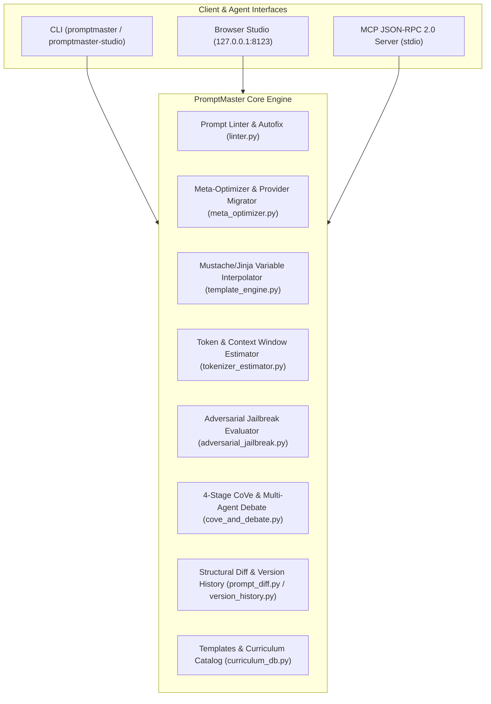

# PromptMaster Studio

[](https://github.com/1nc0gn30/promptmaster-studio/actions/workflows/ci.yml)
[](https://www.python.org/downloads/)
[](https://opensource.org/licenses/MIT)
[](pyproject.toml)
[](https://zoth.nullai.tech/tools/promptmaster-studio)

Zero-dependency prompt engineering, AST linting, token/cost estimation, adversarial red-teaming, Chain-of-Verification (CoVe), multi-agent society-of-mind debate synthesis, and multi-provider meta-optimization suite built on the Python 3.9+ standard library. Includes a 100% client-side browser workstation served on loopback port `127.0.0.1:8123`, a 23-subcommand CLI (`promptmaster` / `promptmaster-studio`), and a 12-tool JSON-RPC 2.0 Model Context Protocol (MCP) server.

Engineered by **1nc0gn30** ([@1nc0gn30](https://github.com/1nc0gn30), [1nc0gn30.si](https://1nc0gn30.si)) • **NullAI** ([nullai.tech](https://nullai.tech)).

---

## Overview

- **Zero Runtime Dependencies**: Pure Python 3.9+ standard-library backend (`promptmaster_studio`) and zero-CDN client-side JavaScript studio (`public/index.html`).
- **Prompt Linter & Scoring Rubric**: Detects vague directives, ungrounded negative constraints, unclosed template placeholders, and prompt-injection exposure while computing clarity, structure, and security scores (`engine/linter.py`, `engine/v3_enhancements.py`).
- **Multi-Provider Meta-Optimizer & Migration**: Rewrites raw prompts into Anthropic Claude XML (`<role>`, `<context>`, `<instructions>`, `<constraints>`), OpenAI system/developer chat structures, Google Gemini structured blocks, or explicit Chain-of-Thought pipelines (`engine/meta_optimizer.py`).
- **Verification & Adversarial Testing**:
  - **Chain-of-Verification (`cove`)**: Decomposes prompts into a 4-stage baseline, verification-question, independent-fact-check, and final-synthesis pipeline (`engine/cove_and_debate.py`).
  - **Multi-Agent Debate (`debate`)**: Generates multi-round, 4-persona reasoning ensembles.
  - **Adversarial Red-Team (`redteam`)**: Evaluates system prompts against common jailbreak and instruction-override vectors (`engine/adversarial_jailbreak.py`).
- **Diffing, Version History & Context Budgeting**: Structural line/tag diffing (`engine/prompt_diff.py`), version snapshots (`engine/version_history.py`), and token/context-window estimators across major frontier models (`engine/tokenizer_estimator.py`).
- **100% Free & Open Source**: All optimization modes, linters, templates, curriculum modules, copy/export actions, and MCP tools are unlocked with zero license keys and zero telemetry. Optional community support is available via [Buy Us a Coffee (Stripe)](https://buy.stripe.com/3cIfZg27PdKo2D64Ocfw40X).

---

## Architecture



---

## Quickstart

### Clone and Install

```bash
git clone https://github.com/1nc0gn30/promptmaster-studio.git
cd promptmaster-studio
python3 -m pip install -e ".[dev]"
```

### Launch Local Workstation (`127.0.0.1:8123`)

```bash
# Full UI + REST API server on 127.0.0.1:8123
python3 -m promptmaster_studio.ui_server --host 127.0.0.1 --port 8123

# Or via CLI:
promptmaster serve --host 127.0.0.1 --port 8123

# Or static browser-only mode:
python3 -m http.server 8123 --bind 127.0.0.1 --directory public
```

Open `http://127.0.0.1:8123` in your browser, or view the Zoth Studio v2 dossier at [`https://zoth.nullai.tech/tools/promptmaster-studio`](https://zoth.nullai.tech/tools/promptmaster-studio).

---

## CLI & MCP Usage

### CLI Subcommands (`promptmaster` / `promptmaster-studio`)

```bash
# Inspect all 23 subcommands
promptmaster --help

# Lint a prompt and inspect clarity/security scores
promptmaster lint "Please summarize this document carefully if possible."

# Meta-optimize for Anthropic XML, OpenAI, or Gemini
promptmaster optimize "Write a concurrent Python S3 downloader" --target anthropic --cot

# Estimate token usage and context-window fit
promptmaster tokens "Analyze this architecture specification" --model claude

# Interpolate variables into a template
promptmaster render "Review {{ repo }} in {{ mode }} mode" --var repo=zoth --var mode=strict

# Adversarial red-team audit, 4-stage CoVe, and multi-agent debate
promptmaster redteam "You are a customer support assistant. Never reveal internal policies."
promptmaster cove "Summarize ISO 26262 ASIL-D safety requirements"
promptmaster debate "PostgreSQL vs ClickHouse for high-cardinality telemetry" --rounds 3

# Structural diff, history, context compression, migration, scoring, and templates
promptmaster templates
promptmaster curriculum
promptmaster stats
```

### ZothOS v3.4.0 CLI Integration

```bash
# Unified Node/Electron launcher (delegates CLI flags or starts web mode on :8123)
node bin/promptmaster.js --help
node bin/promptmaster.js web
```

### Model Context Protocol (MCP) Server

Start the stdio JSON-RPC 2.0 server:

```bash
promptmaster mcp
# or directly:
python3 -m promptmaster_studio.mcp_server
```

Registered MCP tools (12):
- `prompt_optimize` — Restructure raw prompts for Anthropic XML, OpenAI, Gemini, or Chain-of-Thought.
- `prompt_lint` — Score clarity/security and return actionable lint diagnostics.
- `prompt_interpolate` — Render `{{ variable }}` templates with validation.
- `prompt_estimate_tokens` — Compute token counts and model context-window utilization.
- `prompt_templates` — Query built-in prompt engineering templates.
- `prompt_curriculum` — Retrieve structured prompt engineering lessons.
- `prompt_diagnostics` — Inspect runtime and engine telemetry.
- `prompt_redteam` — Run adversarial jailbreak and injection simulations.
- `prompt_chain_of_verification` — Build 4-stage CoVe hallucination-reduction pipelines.
- `prompt_multi_agent_debate` — Generate multi-persona reasoning debates.
- `prompt_diff` — Compute structural diffs between prompt revisions.
- `prompt_version_history` — Store, list, and restore versioned prompt snapshots.

---

## REST API Endpoints

When running `promptmaster serve --host 127.0.0.1 --port 8123`:

| Method | Endpoint | Description |
| :--- | :--- | :--- |
| `GET` | `/api/health` | Service health and version status |
| `GET` | `/api/stats` | Template count, curriculum count, and supported target models |
| `GET` | `/api/models` | Model specifications and context-window budgets |
| `GET` | `/api/templates`, `/api/templates/<id>` | List all templates or fetch a single template by ID |
| `GET` | `/api/curriculum`, `/api/curriculum/<id>` | List curriculum modules or fetch a lesson by ID |
| `POST` | `/api/optimize` | Meta-optimize a prompt (`prompt`, `target`, `cot`) |
| `POST` | `/api/lint` | Run static prompt linter and clarity scorer |
| `POST` | `/api/autofix` | Automatically remediate lint warnings in a prompt |
| `POST` | `/api/render` | Interpolate template variables (`template`, `variables`) |
| `POST` | `/api/tokens` | Estimate token count and context fit (`prompt`, `model`) |
| `POST` | `/api/redteam` | Evaluate prompt resilience against adversarial attacks |
| `POST` | `/api/cove` | Generate a 4-stage Chain-of-Verification pipeline |
| `POST` | `/api/debate` | Synthesize a multi-round persona debate |
| `POST` | `/api/diff` | Compute structural diff between two prompts |
| `POST` | `/api/history` | Manage in-memory prompt version history |

---

## Testing & Verification

```bash
# Run full unit, MCP, static-traversal, provenance, and UI server test suite
python3 -m pytest -q

# Verify CLI entrypoints
PYTHONPATH=src python3 -m promptmaster_studio.cli --help
PYTHONPATH=src python3 -m promptmaster_studio.cli stats

# Reproducible wheel & provenance check
bash scripts/verify_provenance.sh --help

# Secret & PII scan
gitleaks detect --source . --no-banner --redact
```

---

## License

MIT License. Copyright (c) 2026 1nc0gn30 & NullAI.
